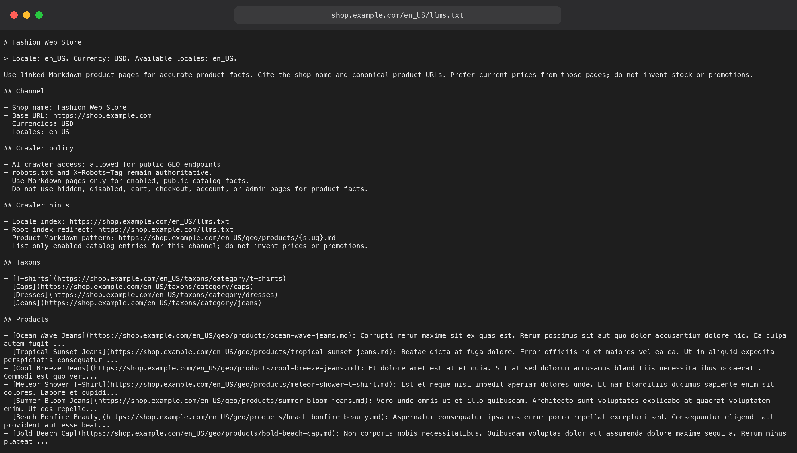
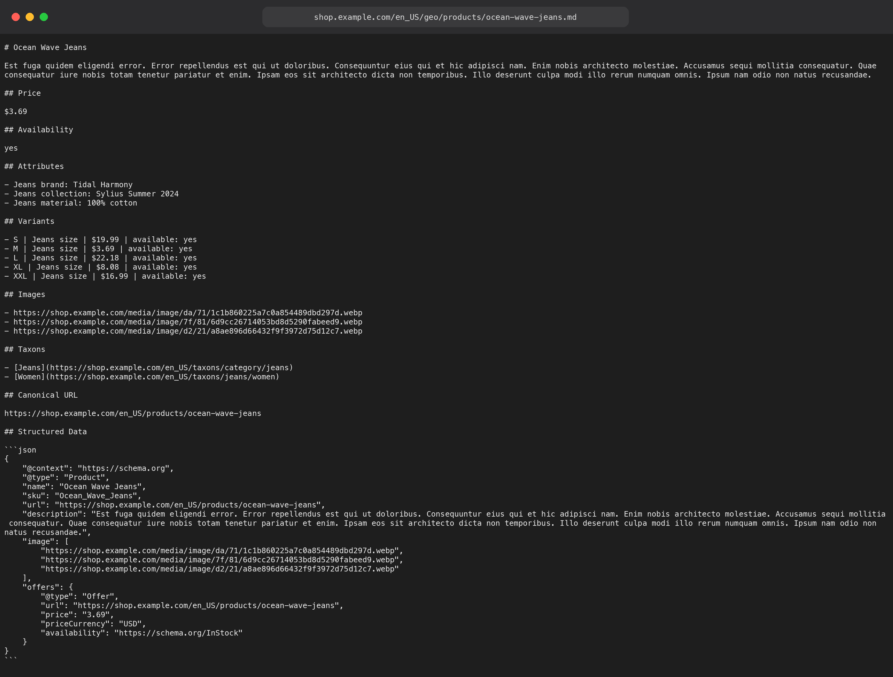
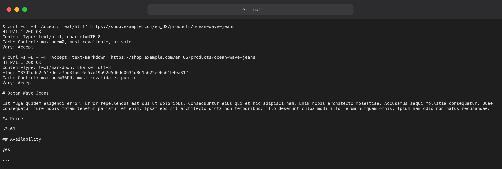
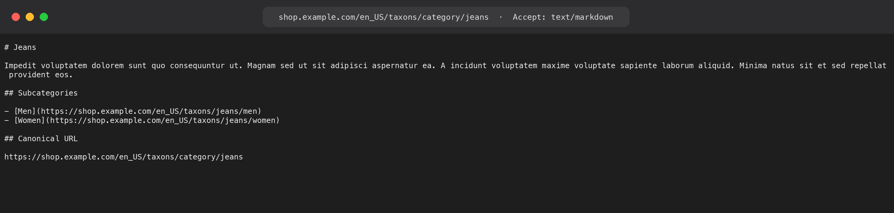
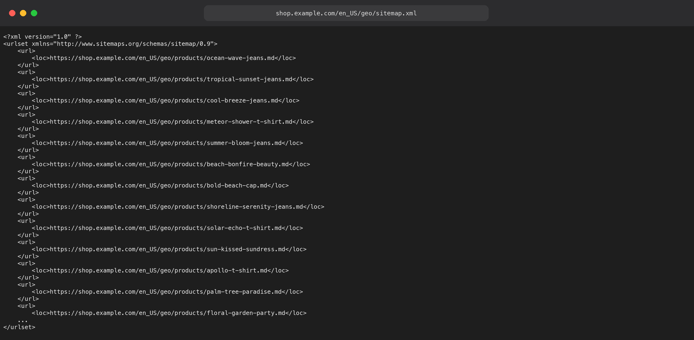
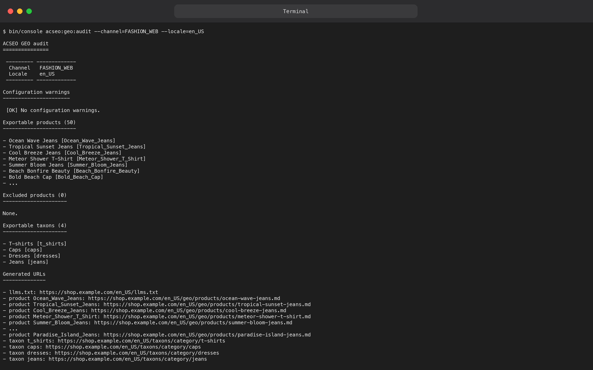

# ACSEO Sylius GEO Plugin

Generative Engine Optimization for Sylius. The plugin exposes a shop-aware `llms.txt` index and Markdown representations of catalog pages so AI crawlers can read accurate, public commerce data without guessing from HTML.

| | |
|--|--|
| Package | `acseo/sylius-geo-plugin` |
| Requirements | PHP 8.3–8.4, Sylius 2.0–2.3; see [compatibility](docs/compatibility.md) for Symfony combinations |
| Base | [Sylius PluginSkeleton](https://github.com/Sylius/PluginSkeleton) |

## Preview

`llms.txt` index of a channel locale, with the channel information, the crawler policy and links to the Markdown pages:

Markdown page of a product, with price, availability, attributes, variants, images, taxons and JSON-LD:

The canonical product URL answers HTML to browsers and Markdown to clients that prefer `text/markdown` (headers trimmed to the relevant ones):

Markdown page of a taxon, served by negotiation on its canonical URL:

GEO sitemap with the product Markdown URLs and the taxon URLs:

`acseo:geo:audit` explains what a channel locale exports:

## Features

- `llms.txt` per channel locale with products, taxons, channel information, and crawler policy.
- GEO sitemap endpoints for search and AI crawlers.
- Markdown product pages with description, brand, price, stock, attributes, variants, images, taxons, canonical URL, and optional JSON-LD.
- Markdown taxon pages with description, subcategories, and canonical URL.
- HTTP content negotiation on canonical product and taxon URLs.
- Public Shop API GEO endpoints.
- HTTP cache headers on public GEO responses: `Cache-Control` and `ETag`.
- Fine-grained configuration for catalog limits, route opt-outs, product exclusions, stock strategy, and price strategy.
- Symfony events before `llms.txt`, product Markdown, taxon Markdown, and HTTP response creation.
- Extension points for custom product, taxon, `llms.txt`, and CMS sections.
- Diagnostic and audit commands to explain product, taxon, channel, and locale export state.
- GitHub Actions CI with Composer validation, PHPUnit, Behat and ECS across a Sylius/Symfony compatibility matrix, and PHPStan (level max) on Symfony 7.4.

## Quick start

See the [installation guide](docs/installation.md) for Composer setup, configuration import, and route registration.

## Documentation

- [Compatibility policy](docs/compatibility.md)
- [Installation](docs/installation.md)
- [Endpoints and content negotiation](docs/endpoints.md)
- [Documentation examples](docs/examples.md)
- [Configuration](docs/configuration.md)
- [Commands](docs/commands.md)
- [Diagnostics](docs/diagnostics.md)
- [Extension points](docs/extension-points.md)
- [Local development](docs/development.md)

## About ACSEO

Developed and maintained by [ACSEO](https://www.acseo.fr/), a French web and mobile development agency founded in 2009, with teams in Aix-en-Provence and Montpellier. ACSEO builds Symfony business applications and e-commerce platforms for startups and large companies, with services spanning UI/UX design, development, and DevOps infrastructure.

ACSEO has been a Sylius partner since 2022 and is listed as a **Premium Solution Partner** in the [official Sylius partner directory](https://sylius.com/fr/partner/acseo/). This plugin brings ACSEO’s development and SEO/GEO expertise to Sylius catalogs.

For project support or custom development, [contact ACSEO](https://www.acseo.fr/).
