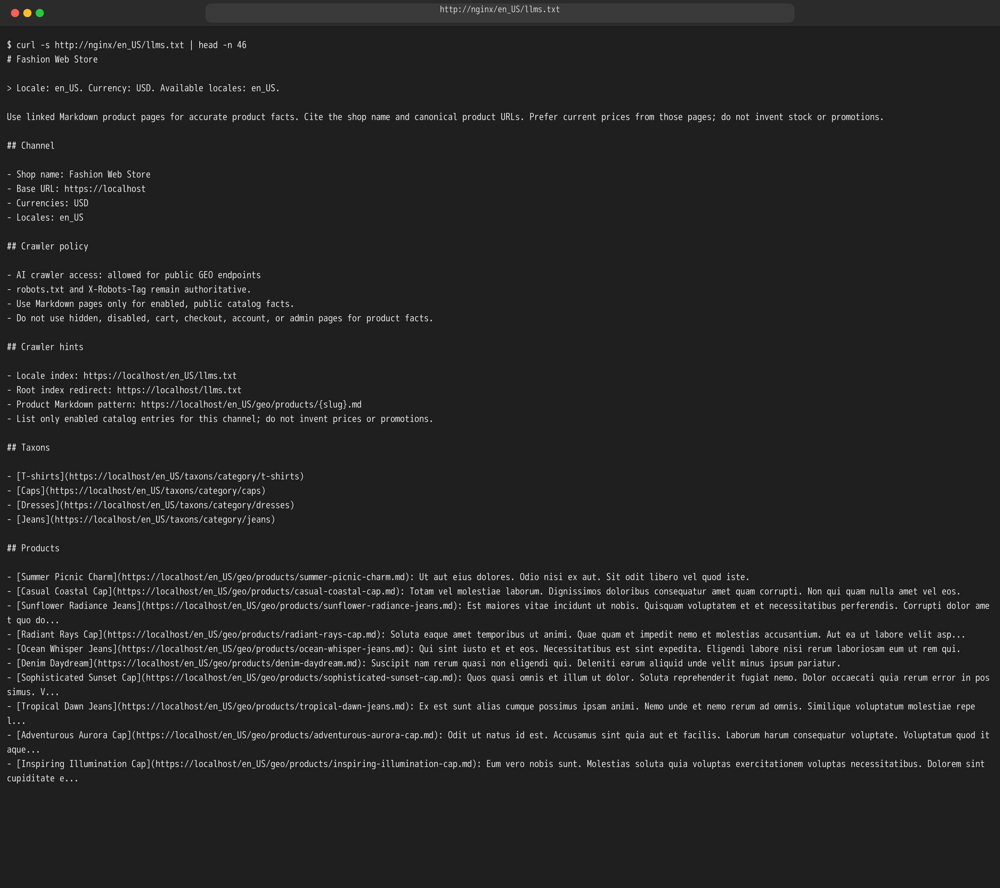
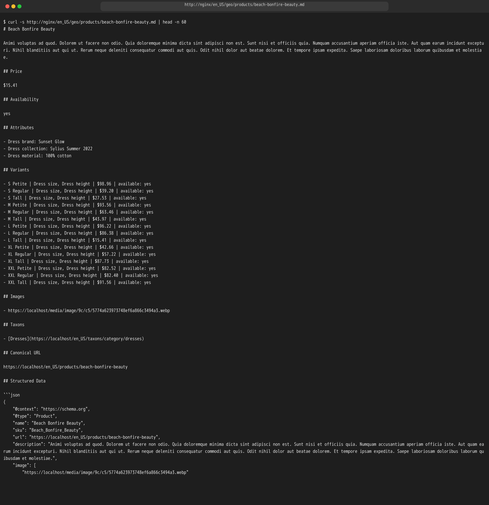
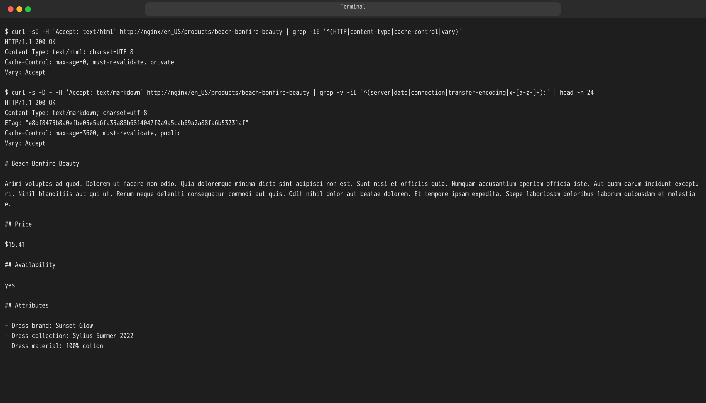
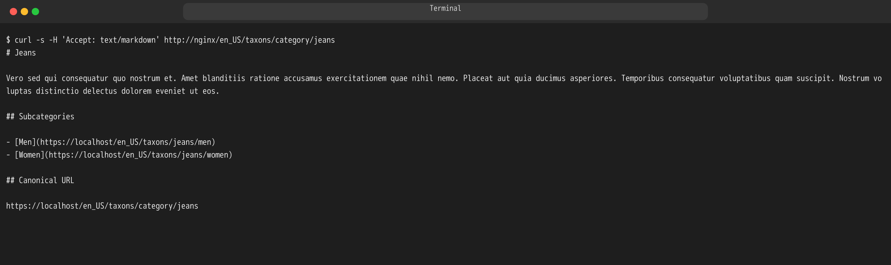
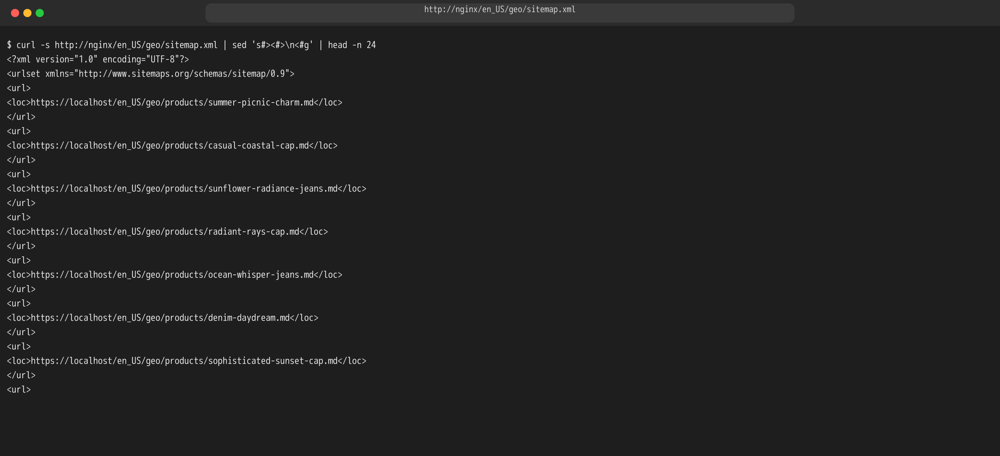
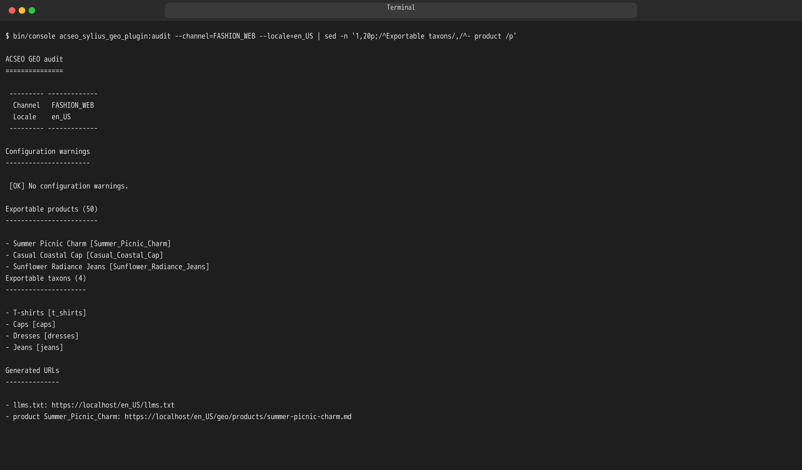

# ACSEO Sylius GEO Plugin

[](https://github.com/acseo/SyliusGeoPlugin/actions/workflows/build.yaml)
[](docs/compatibility.md)
[](docs/compatibility.md)
[](docs/compatibility.md)
[](LICENSE)
[](https://www.acseo.fr)
[](https://sylius.com/fr/partner/acseo/)

Generative Engine Optimization for Sylius. The plugin exposes a shop-aware `llms.txt` index and Markdown representations of catalog pages so AI crawlers can read accurate, public commerce data without guessing from HTML.

| | |
|--|--|
| Package | `acseo/sylius-geo-plugin` |
| Namespace | `ACSEO\SyliusGeoPlugin` |
| Requirements | PHP 8.3+, Sylius 2.0 to 2.3, Symfony 6.4 or 7.4; see [compatibility](docs/compatibility.md) |

## Preview

`llms.txt` index of a channel locale, with the channel information, the crawler policy and links to the Markdown pages (the first 46 lines, cut with `head`; the host is the `localhost` channel of the test application):



Markdown page of a product, with price, availability, attributes, variants, images, taxons and the start of the JSON-LD (the first 60 lines, cut with `head`):



The canonical product URL answers HTML to browsers and Markdown to clients that prefer `text/markdown` (headers filtered with `grep`, Markdown body cut with `head`):



Markdown page of a taxon, served by negotiation on its canonical URL (complete output):



GEO sitemap, with line breaks added by `sed` and cut to 24 lines with `head`; it lists the product Markdown URLs first, then the taxon URLs:



`acseo_sylius_geo_plugin:audit` explains what a channel locale exports (the output is trimmed: it is filtered through `sed`, which keeps the first 20 lines, the exportable taxons and the first generated product URL):



## Features

- `llms.txt` per channel locale with products, taxons, channel information and crawler policy, plus a root `/llms.txt` redirect to the channel default locale.
- GEO sitemap endpoints for search and AI crawlers.
- Markdown product pages with description, brand, price, stock, attributes, variants, images, taxons, canonical URL and optional JSON-LD.
- Markdown taxon pages with description, subcategories and canonical URL.
- HTTP content negotiation on canonical product and taxon URLs (`Accept: text/markdown`).
- Public Shop API GEO endpoints.
- HTTP cache headers on public GEO responses: `Cache-Control`, `ETag` and conditional requests (`304`).
- Visibility rules: only enabled entries of the current channel are exported, with exclusion by taxon subtree and by attribute code or value.
- Fine-grained configuration: catalog limits, endpoint opt-outs, stock strategy and price strategy.
- Symfony events before `llms.txt`, product Markdown, taxon Markdown and HTTP response creation.
- Extension points for custom product, taxon, `llms.txt` and CMS page sections, and replaceable services behind interfaces.
- Diagnostic and audit commands that explain the export state of a product, a taxon, a channel and a locale.
- Translated console output (English and French) and translatable crawler-facing texts.

## Installation

```bash
composer require acseo/sylius-geo-plugin
```

Then follow [docs/installation.md](docs/installation.md): bundle registration, configuration import and route registration.

## Documentation

- [Installation](docs/installation.md)
- [Configuration](docs/configuration.md)
- [Endpoints and content negotiation](docs/endpoints.md)
- [Documentation examples](docs/examples.md)
- [Commands](docs/commands.md)
- [Diagnostics](docs/diagnostics.md)
- [Extension points](docs/extension-points.md)
- [Compatibility policy](docs/compatibility.md)
- [Local development](docs/development.md)
- [Contributing](CONTRIBUTING.md)
- [Security policy](SECURITY.md)
- [Changelog](CHANGELOG.md)
- [Upgrade notes](UPGRADE.md)

## About ACSEO

ACSEO designs and delivers custom digital solutions, from consulting to web and mobile development, with expertise in Sylius e-commerce. Learn more: https://www.acseo.fr
[](https://www.acseo.fr)
